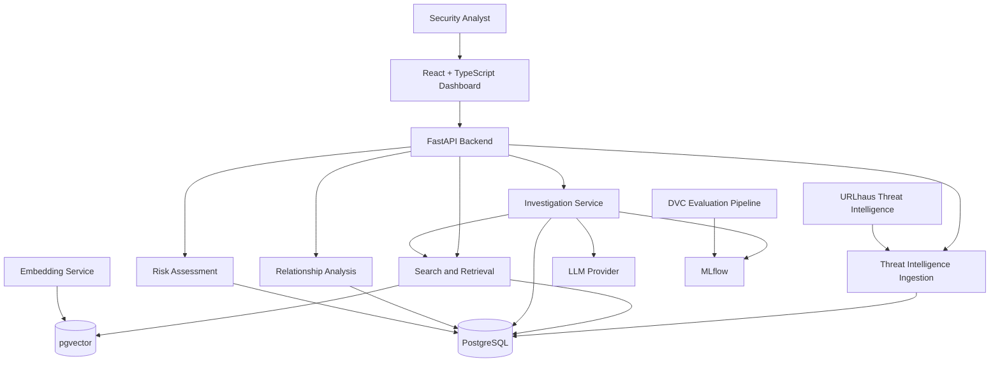

# CypherNex
### AI-Powered Digital Threat Intelligence and Investigation Assistant

<p align="center">
  <strong>Turn threat intelligence data into searchable evidence, connected investigations, and source-backed security insights.</strong>
</p>

<p align="center">
  
  
  
  
  
  
  
</p>

---

## Overview

**CypherNex** is an AI-powered digital threat intelligence and investigation platform designed to help security analysts collect, search, investigate, and understand cybersecurity threat data.

The platform combines real-world threat intelligence ingestion, Retrieval-Augmented Generation (RAG), semantic search, relationship analysis, risk assessment, and source-backed AI-generated investigation reports.

Rather than presenting isolated indicators, CypherNex helps investigators explore potential connections between threat intelligence records and understand the evidence supporting those connections.

A key design principle is the distinction between **observed evidence, analytical inference, and confirmed facts**. Shared indicators, infrastructure, metadata, or temporal proximity can suggest relationships, but they do not independently establish threat-actor attribution or compromise.

## Key Features

### 1. Threat Intelligence Ingestion
- Collect threat intelligence records from the URLhaus threat intelligence platform.
- Ingest URLs and associated hostname indicators.
- Store source records and provenance information.
- Maintain document-to-indicator relationships.
- Avoid duplicate records through deduplication.

### 2. Searchable Threat Intelligence Dashboard
- Search ingested threat intelligence documents.
- Search indicators and associated information.
- Explore collected records through the web interface.
- Access investigation and threat analysis features from a centralized dashboard.

### 3. AI-Assisted Investigations
- Submit natural-language investigation queries.
- Retrieve relevant threat intelligence evidence using RAG.
- Analyze possible relationships across retrieved records.
- Generate investigation reports grounded in retrieved source material.
- Preserve investigation history for later review.

### 4. Relationship Graph
- Visualize documents and indicators as connected entities.
- Explore document-to-indicator relationships.
- Discover potential cross-document relationships.
- Examine shared reporters, tags, URL paths, and temporal proximity.

Relationships represent analytical observations and should not automatically be interpreted as proof of common ownership or malicious attribution.

### 5. Risk Assessment
- Generate risk assessments using source-based indicators and rule-based analysis.
- Categorize findings into risk levels.
- Present supporting source information.
- Distinguish automated risk triage from confirmed compromise.

### 6. Source-Backed Investigation Reports
- Generate structured investigation reports.
- Associate findings with source references.
- Preserve source URLs and retrieved evidence.
- Include evidence citations in investigation output.
- Distinguish possible relationships from established facts.

### 7. RAG Evaluation and Experiment Tracking
- Evaluate retrieval performance using a labelled evaluation dataset.
- Measure Precision@K, Recall@K, Mean Reciprocal Rank, and retrieval latency.
- Track evaluation metrics with MLflow.
- Use DVC to manage reproducible evaluation pipelines and metrics.

---

## System Architecture

CypherNex follows a modular architecture consisting of a React frontend, FastAPI backend, PostgreSQL database, RAG services, and experiment-tracking infrastructure.



### Data Flow

1. Threat intelligence records are collected from URLhaus.
2. The ingestion service validates and stores source records.
3. Indicators are extracted and associated with their corresponding documents.
4. Documents can be processed by the RAG indexing and embedding pipeline.
5. User queries are processed through semantic and lexical retrieval.
6. Relevant evidence is passed to the investigation service.
7. The investigation service generates an evidence-based analytical report.
8. Relationships and risk assessments are made available through the dashboard.
9. Evaluation metrics and experiment information are tracked using DVC and MLflow.

---

## Technology Stack

| Component | Technology |
|---|---|
| Backend | Python, FastAPI |
| Frontend | React, TypeScript, Vite |
| UI Routing | React Router |
| Frontend HTTP Client | Axios |
| Database | PostgreSQL |
| Vector Storage | PostgreSQL with pgvector |
| ORM | SQLAlchemy |
| Database Migrations | Alembic |
| AI Architecture | Retrieval-Augmented Generation (RAG) |
| Embeddings | BAAI/bge-m3 |
| Embedding Runtime | Ollama |
| LLM Integration | Modular provider architecture |
| Threat Intelligence Source | URLhaus |
| Experiment Tracking | MLflow |
| Pipeline and Metrics Management | DVC |
| Containerization | Docker and Docker Compose |

---

## Repository Structure

```text
cyphernex-threat-intelligence/
│
├── backend/
│   ├── app/
│   │   ├── api/
│   │   │   └── routes/
│   │   ├── db/
│   │   ├── integrations/
│   │   ├── models/
│   │   ├── schemas/
│   │   └── services/
│   │       ├── ingestion/
│   │       └── rag/
│   │
│   └── scripts/
│
├── frontend/
│   └── src/
│       ├── components/
│       ├── features/
│       │   └── ingestion/
│       ├── services/
│       └── types/
│
├── data/
│   └── evaluation/
│
├── reports/
│
├── dvc.yaml
├── dvc.lock
├── docker-compose.yml
├── README.md
└── .gitignore
```

*The structure above highlights the main application areas; individual files and additional directories may evolve as the project develops.*

---

## Getting Started

### Prerequisites

Install the following software before running CypherNex:

- Git
- Docker Desktop with Docker Compose
- Python 3.12 or a compatible supported Python version
- Node.js and npm (for local frontend development)
- Ollama (if using the local embedding service)
- A URLhaus API Auth-Key for authenticated threat intelligence ingestion
- An LLM provider API key if the selected provider requires one

### 1. Clone the Repository

```bash
git clone https://github.com/farhannaeem00/cyphernex-threat-intelligence.git

cd cyphernex-threat-intelligence
```

### 2. Configure Environment Variables

Review the environment configuration referenced by `docker-compose.yml` and the backend application.

Create your local `.env` file using the project's environment template if one is provided:

```powershell
Copy-Item .env.example .env
```

Configure the required database credentials, URLhaus authentication, and AI provider settings according to the variable names used by the application.

**Important:** Never commit `.env` files, API keys, database passwords, or other credentials to GitHub.

### 3. Start the Application with Docker

Build and start the services:

```bash
docker compose up -d --build
```

Check service status:

```bash
docker compose ps
```

View application logs:

```bash
docker compose logs -f
```

View backend logs:

```bash
docker compose logs -f backend
```

### 4. Access the Application

Once the services are running:

| Service | URL |
|---|---|
| Frontend Dashboard | http://localhost:5173 |
| Backend API | http://localhost:8000 |
| API Documentation | http://localhost:8000/docs |
| MLflow Tracking UI | http://localhost:5000 |

### 5. Stop the Application

```bash
docker compose stop
```

To remove containers and the Compose network without deleting named volumes:

```bash
docker compose down
```

**Do not use `docker compose down -v` if you want to preserve persistent database and application data.**

---

## Threat Intelligence Data Source

CypherNex currently integrates with:

### URLhaus

URLhaus is a threat intelligence initiative operated by abuse.ch that focuses on collecting and sharing information about malicious URLs used for malware distribution.

Official resources:

- Website: https://urlhaus.abuse.ch/
- API documentation: https://urlhaus.abuse.ch/api/

URLhaus records are used as real threat intelligence input for ingestion, indicator extraction, searching, relationship analysis, and investigation.

The project preserves source provenance so that analytical output can be traced back to the original records.

---

## Retrieval-Augmented Generation (RAG)

CypherNex uses a Retrieval-Augmented Generation architecture to ground AI-assisted investigations in stored threat intelligence evidence.

### Retrieval Pipeline

1. User submits an investigation query.
2. The query is converted into an embedding.
3. Relevant document chunks are retrieved.
4. Semantic similarity and lexical relevance contribute to retrieval ranking.
5. Retrieved evidence is passed to the investigation service.
6. The language model generates an analytical response using the retrieved context.
7. Source references are included in the resulting report.

### Retrieval Scoring

The current retrieval service combines semantic similarity and lexical overlap:

```text
Combined Score =
    0.82 × Semantic Similarity
  + 0.18 × Lexical Overlap
```

This scoring approach balances semantic relevance with direct term matching.

### Evidence Integrity

CypherNex is designed around the following principles:

- Retrieved evidence should remain traceable to its source.
- Analytical relationships should be described as possible connections where appropriate.
- Shared infrastructure does not establish common ownership.
- Risk classifications should not be interpreted as proof of compromise.
- AI-generated conclusions should not be presented as independently verified facts.

---

## Relationship Analysis

The relationship analysis component identifies possible connections between threat intelligence records.

Examples include:

| Relationship | Meaning |
|---|---|
| Shared indicator | Multiple documents reference the same indicator |
| Shared reporter | Records have overlapping reporter metadata |
| Shared tag | Records contain common threat metadata |
| Shared URL path | Records have a matching URL path |
| Temporal proximity | Records occur within a relevant time window |

These relationships provide investigative leads, not definitive attribution.

Relationship confidence values are heuristic scores and should not be interpreted as calibrated probabilities.

---

## Risk Assessment

CypherNex provides rule-based risk triage using available threat intelligence information.

Risk assessments help analysts prioritize records for further investigation.

The results are intended to support investigation workflows, not replace independent security validation.

A high-risk classification does not, by itself, prove that a system has been compromised.

---

## API Overview

The backend exposes REST API endpoints through FastAPI.

Interactive API documentation is available at:

```text
http://localhost:8000/docs
```

### Main Endpoints

| Method | Endpoint | Purpose |
|---|---|---|
| GET | `/health` | Backend health check |
| GET | `/api/search/` | Search documents and indicators |
| GET | `/api/graph/` | Retrieve relationship graph data |
| GET | `/api/risks/` | Retrieve risk assessments |
| GET | `/api/investigations/` | Retrieve investigation history |
| POST | `/api/investigations/run` | Execute an AI-assisted investigation |
| GET | `/api/investigations/{investigation_id}` | Retrieve a saved investigation |

### Example: Health Check

```bash
curl http://localhost:8000/health
```

### Example: Search

```bash
curl "http://localhost:8000/api/search/?q=URLhaus&limit=5"
```

### Example: Relationship Graph

```bash
curl http://localhost:8000/api/graph/
```

### Example: Risk Assessments

```bash
curl http://localhost:8000/api/risks/
```

### Example: Investigation Request

```bash
curl -X POST "http://localhost:8000/api/investigations/run" \
  -H "Content-Type: application/json" \
  -d '{
    "query": "Investigate the available URLhaus threat intelligence records and identify possible connections across the associated URLs and hostnames.",
    "limit": 6
  }'
```

Refer to the interactive API documentation for the complete request and response schemas.

---

## Evaluation and Experiment Tracking

CypherNex uses DVC and MLflow to support reproducible RAG evaluation and experiment tracking.

### Evaluation Metrics

The evaluation pipeline measures:

- **Precision@K:** Proportion of retrieved results that are relevant within the top K results.
- **Recall@K:** Proportion of relevant results retrieved within the top K results.
- **Mean Reciprocal Rank (MRR):** Ranking quality based on the position of the first relevant result.
- **Mean Latency:** Average retrieval execution time.

### Recorded Evaluation Baseline

The following metrics were recorded in the project's evaluation run:

| Metric | Result |
|---|---:|
| Queries evaluated | 5 |
| K | 5 |
| Precision@5 | 0.20 |
| Recall@5 | 0.60 |
| MRR | 0.60 |
| Mean latency | 5,786.74 ms |

These results represent the current evaluation baseline using a small five-query evaluation dataset. They should not be interpreted as evidence of production-scale retrieval performance.

### DVC

DVC manages the RAG evaluation pipeline and its tracked metrics.

Check pipeline status:

```bash
dvc status
```

Display recorded metrics:

```bash
dvc metrics show
```

Run the evaluation pipeline:

```bash
dvc repro
```

### MLflow

MLflow tracks evaluation experiments, parameters, metrics, and artifacts.

Open the tracking UI:

```text
http://localhost:5000
```

The recorded evaluation run:

| Field | Value |
|---|---|
| Experiment | `cyphernex-rag-evaluation` |
| Experiment ID | `1` |
| Run ID | `2e979ea2158f43e1abbcfecc92c6db18` |
| Run status | `FINISHED` |

---

## Database and Data Management

CypherNex uses PostgreSQL for structured threat intelligence storage.

The database stores information associated with:

- Documents
- Indicators
- Findings
- Citations
- Relationships
- Document-indicator associations
- Investigation records

Database schema changes are managed through Alembic migrations.

Database data should be preserved when restarting or rebuilding application containers.

Do not use destructive database reset commands on an existing installation unless you have verified backups and explicitly intend to reset the data.

---

## Testing and Quality Assurance

The project has undergone application and integration checks covering:

- Backend health endpoint.
- Frontend build.
- Frontend-to-backend API connectivity.
- Document and indicator search.
- Relationship graph retrieval.
- Risk assessment retrieval.
- Investigation creation and persistence.
- Saved investigation retrieval.
- Docker service health.
- DVC evaluation reproducibility.
- MLflow experiment tracking.

The final integration checks completed successfully for the tested application workflows.

---

## Known Limitations and Future Improvements

CypherNex is an evolving threat intelligence investigation platform. The following areas provide opportunities for further development.

### Current Limitations

- URLhaus is the currently integrated live threat intelligence source.
- The evaluation dataset contains only five queries and is not sufficient for broad performance generalization.
- Risk assessments use rule-based triage and should not be interpreted as probabilities.
- Relationship confidence scores are heuristic.
- Citation reference validation does not independently establish semantic entailment between every claim and its source.
- Shared indicators and infrastructure do not prove common threat-actor attribution.
- Retrieval performance and scalability require additional testing with larger datasets.

### Potential Future Enhancements

- Integrate additional threat intelligence sources.
- Expand labelled evaluation datasets.
- Improve retrieval ranking and document-level evaluation.
- Add stronger evidence-to-claim validation.
- Introduce analyst feedback and investigation review workflows.
- Improve graph-based correlation and relationship explanations.
- Add role-based access control and audit logging.
- Expand automated testing and security validation.
- Optimize retrieval and embedding performance for larger datasets.

---

## Security and Responsible Use

CypherNex is intended to support cybersecurity research, threat intelligence analysis, and defensive security investigations.

Users should:

- Protect API keys and database credentials.
- Avoid committing secrets or sensitive data.
- Verify AI-generated findings against original sources.
- Treat inferred relationships as investigative leads.
- Validate risk assessments independently.
- Avoid treating AI-generated attribution as confirmed fact.

Threat intelligence data may contain malicious URLs and other potentially dangerous indicators. Do not open or execute suspicious resources directly on production systems.

---

## Contributing

Contributions and suggestions are welcome.

A typical contribution workflow:

1. Fork the repository.
2. Create a feature branch.
3. Implement your changes.
4. Test the affected functionality.
5. Submit a pull request with a clear description.

Please avoid committing credentials, local database files, generated artifacts, or personal environment configuration.

---

## Author

**Farhan Naeem**

Computer Science | AI Engineering | Cybersecurity | Threat Intelligence

GitHub: [@farhannaeem00](https://github.com/farhannaeem00)

Project Repository: [CypherNex — AI-Powered Digital Threat Intelligence and Investigation Assistant](https://github.com/farhannaeem00/cyphernex-threat-intelligence)

---

## License

No license has been specified for this repository yet.

Unless a license is added, the project should be treated as having all rights reserved. Add an appropriate open-source license if you intend to permit reuse, modification, and redistribution.

---

<p align="center">
  <strong>CypherNex — Connecting Threat Intelligence. Supporting Evidence-Based Investigation.</strong>
</p>
